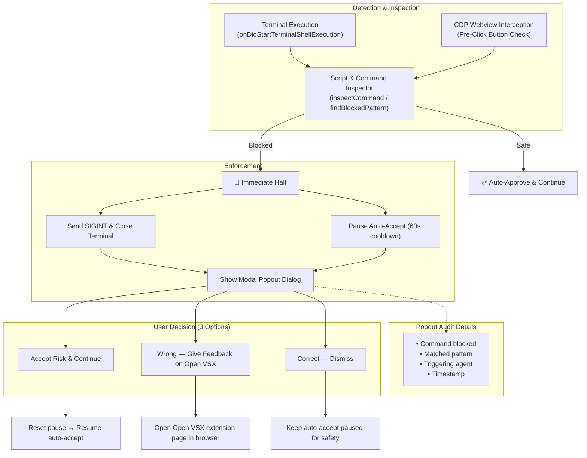
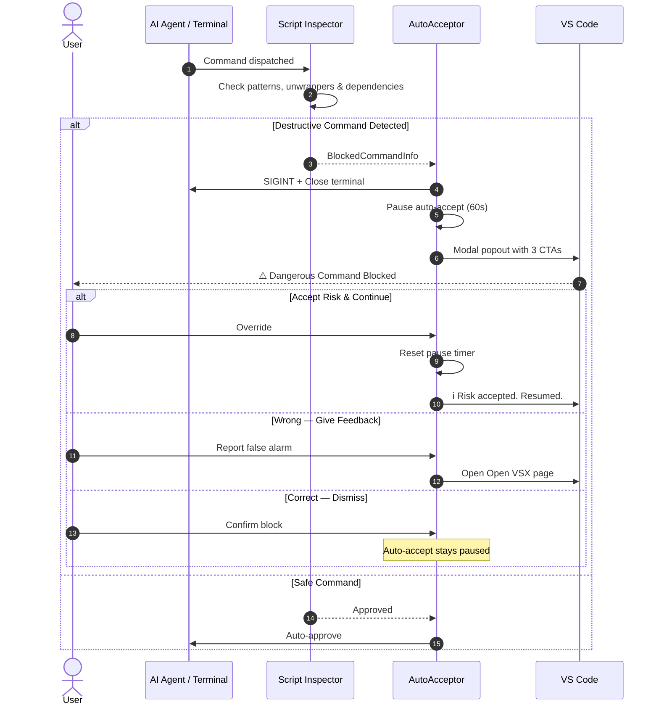

# Auto Accept Antigravity

> Automatically approve AI agent actions in VS Code. Zero config. No launch flags.

[](https://github.com/kaushiksaravanan/Antigravity-AutoAccecpt/releases)
[](LICENSE)
[](https://code.visualstudio.com/)

## Features

- **Instant auto-accept:** Approve agent steps, terminal commands, and file edits automatically.
- **Zero configuration:** Works out of the box, no launch flags, no setup required.
- **Pre-execution gating and script inspection:** A multi-layer blocklist and script inspector intercept destructive commands and script contents before execution. The fail-closed path halts unverified terminal runs.
- **Interactive security popout & feedback:** When a dangerous or malicious command is detected and blocked, auto-accept immediately pauses execution and displays a modal alert with full details (command, matched pattern, triggering agent, timestamp). Users can choose to **Accept Risk & Continue**, submit false-alarm feedback directly to Open VSX (**Wrong**), or dismiss cleanly (**Correct**).
- **Full control:** Settings-based configuration for polling speed, button interception, and custom commands.
- **CDP fallback:** Optional Chrome DevTools Protocol support for clicking buttons in webviews.
- **Diagnostics:** Built-in checks of which VS Code commands are available.

## Quick start

1. Install from VS Code Marketplace: [Auto Accept Antigravity](https://marketplace.visualstudio.com/items?itemName=kaushiksaravanan.auto-accept-antigravity)
2. Click the status bar icon (bottom right) to toggle on
3. Start using Antigravity; approvals happen automatically

## Usage

### Commands

- `Auto Accept: Toggle`: turn on or off from the status bar or Command Palette
- `Auto Accept: Start`: activate auto-accept
- `Auto Accept: Stop`: deactivate auto-accept
- `Auto Accept: Accept All Now` (`Cmd+Shift+Y` / `Ctrl+Shift+Y`): fire pending approvals
- `Auto Accept: Run Diagnostics`: check available commands

### Configuration

Open VS Code Settings and search for `autoAcceptAgent`:

```json
{
  "autoAcceptAgent.enableCommandPolling": true,
  "autoAcceptAgent.pollIntervalMs": 800,
  "autoAcceptAgent.autoConfigureSettings": true,
  "autoAcceptAgent.interceptNotifications": true,
  "autoAcceptAgent.enableCDP": false,
  "autoAcceptAgent.cdpPort": 9222,
  "autoAcceptAgent.blockedCommands": [
    "rm -rf /",
    "rm -rf",
    "format",
    "mkfs",
    "del",
    "del *",
    "rmdir",
    "rd",
    "erase",
    "Remove-Item",
    "git push --force",
    "git reset --hard",
    "git clean -fd"
  ],
  "autoAcceptAgent.customButtonTexts": []
}
```

See [docs/configuration.md](docs/configuration.md) for all options.

## How it works

Four strategies work together:

1. **Settings injection** writes chat auto-approve settings, then restores them when stopped. It does not turn off workspace trust.
2. **Command polling** fires agent accept commands on a timer. It does not accept unrelated notification popups.
3. **Event tracking** closes a terminal that starts a blocked command and reacts to editor changes.
4. **CDP fallback** (optional) clicks approval buttons in VS Code webviews after the blocklist check.

[Read the full technical overview](docs/how-it-works.md)

### Security Interception & Popout Flow

When a dangerous command is detected, here is exactly what happens:





## Examples

Check [examples/](examples/) for configuration templates:
- Basic setup
- Security-hardened mode
- Aggressive and relaxed polling

## FAQ

**Q: Is this safe?**
A: It is safer than clicking every approval, and it is not a sandbox. Blocked shell commands are interrupted when shell integration reports them, and the optional CDP path refuses the click when it can see the text. Customize the list in settings. Workspace trust is left alone.

**Q: Does it slow down VS Code?**
A: No. Polling runs at low priority (800ms default, adjustable).

**Q: Works with terminal commands?**
A: Yes. Approves terminal execution, file modifications, and agent steps.

**Q: Custom button labels?**
A: Yes. Add to `autoAcceptAgent.customButtonTexts` in settings.

[See full FAQ](docs/faq.md)

## Development

### Build

```bash
npm test             # Blocklist matcher tests
npm run compile      # TypeScript → JavaScript
npm run watch        # Watch mode
npm run package      # Create .vsix
```

### Project structure

```
src/
├── extension.ts         # VS Code entry
├── autoAcceptor.ts      # Start, stop, polling, events, and fail-closed gates
├── catalog.ts           # Command IDs and default blocked command lists
├── blocked.ts           # Token normalizer and pattern matcher
├── scriptInspector.ts   # Local script & package.json dependency inspector
├── settingsGuard.ts     # Snapshot and restore global settings
├── cdpFallback.ts       # Webview DOM inspection and safe button clicks
└── diagnostics.ts       # Diagnostics

test/                    # Matcher tests and manual scripts
docs/                    # Documentation
examples/                # Config examples
```

See [CONTRIBUTING.md](CONTRIBUTING.md) to contribute.

## Security boundaries

The extension checks in layers:

- **Pre-execution gating:** Terminal auto-approval commands fail closed unless verified by CDP or explicitly opted into via `allowBlindTerminalAccept`.
- **Flag canonicalization:** Command strings are normalized (for example `rm -fr`, `/bin/rm -rf`, `git push origin --force`) so flag splitting and path variations cannot evade the blocklist.
- **Script inspection:** Commands that invoke shell scripts (`bash`, `sh`), Python, or Node, and `npm run` tasks, are inspected for nested destructive patterns before approval.
- **Application-scoped settings:** Critical security controls are enforced at Application scope so a malicious workspace repository cannot override blocklists.
- **Not a hardware sandbox:** Dynamic runtime behavior (network downloads, obfuscated code, or precompiled binaries) cannot be verified statically; run such workloads in disposable containers or sandbox environments.

## License

MIT, see [LICENSE](LICENSE)

## Author

[Kaushik Saravanan](https://github.com/kaushiksaravanan)

**Status:** Actively maintained. Issues and PRs welcome.
