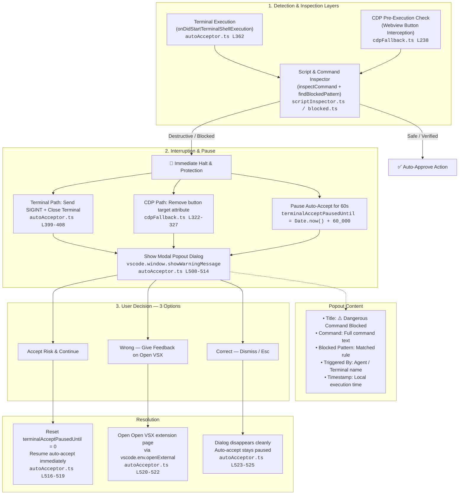
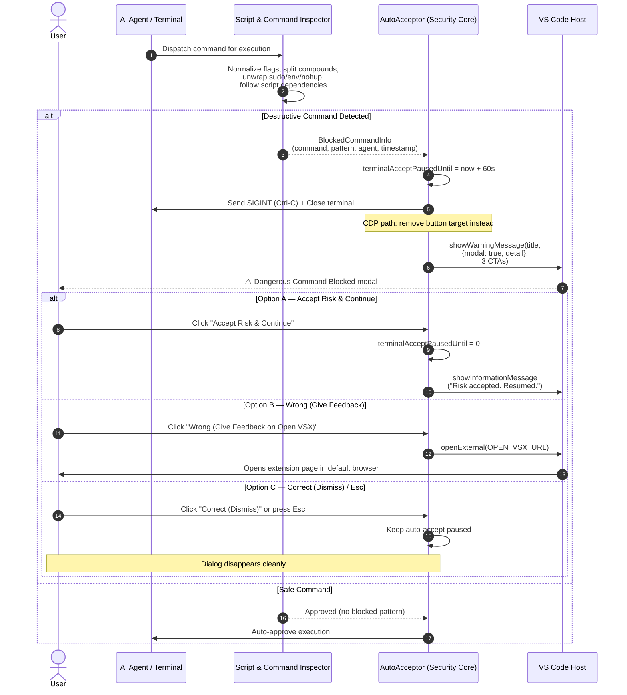
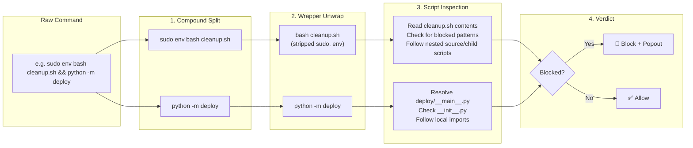

# How Auto Accept Works

Auto Accept uses four strategies. They do not all see the same information, so the blocked-command check is not the same on every path.

## Strategy 1: Settings injection

Turning Auto Accept on writes user-level chat and terminal settings, then restores the previous values when it stops. The previous values are saved in extension storage before the first write. If the editor closes mid-write, the next launch restores them.

Settings this extension writes:

```
chat.tools.autoApprove = true
chat.agent.autoApprove = true
chat.tools.terminal.enableAutoApprove = true
chat.tools.terminal.autoApprove = true
chat.agent.maxRequests = 999
terminal.integrated.confirmOnKill = never
terminal.integrated.confirmOnPaste = false
```

It does not change `security.workspace.trust`.

Turn this off with `autoAcceptAgent.autoConfigureSettings`.

## Strategy 2: Command polling

Two timers fire known accept commands:

- Fast poll, every half of `pollIntervalMs` (at least 200ms): agent and terminal accept commands.
- Full poll, every `pollIntervalMs` (default 800ms): chat accept and the terminal chat run command.

`notification.acceptPrimaryAction` is not used. That command accepts whatever notification is open.

While CDP is connected, polling does not fire terminal run commands. CDP is the path that can read the command text before the click. If CDP is enabled but the port is closed, polling keeps approving terminal commands and the shell listener still stops blocked ones.

`autoAcceptAgent.enableCommandPolling` turns the timers off. Settings, events, and CDP keep their own switches.

## Strategy 3: Event reactions

- A terminal shell command that matches the blocklist is interrupted, that terminal is closed, and terminal auto-accept pauses for 60 seconds. This requires [shell integration](https://code.visualstudio.com/docs/terminal/shell-integration).
- Focusing a non-file editor, or a change in visible editors, fires agent accept commands.
- Keyboard and mouse selection changes pause polling for 1.5 seconds so the extension does not fight the user.
- Agent edits to a document do not count as user typing.

## Strategy 4: CDP fallback (off by default)

Set `autoAcceptAgent.enableCDP` and launch the editor with `--remote-debugging-port` equal to `autoAcceptAgent.cdpPort` (default 9222).

The fallback connects to that one localhost port, attaches only to `vscode-webview` targets, and clicks Run / Accept after the same blocklist check used for terminal commands. It does not scan a port range and it does not attach to other browser pages.

`autoAcceptAgent.interceptNotifications` controls whether CDP may also click Allow buttons in the agent UI. It does not accept unrelated VS Code notifications.

## Blocked commands & Security Popout

A single word matches the command name only:

- `del temp.txt` is blocked
- `git format-patch` is not blocked by `format`
- `delta` is not blocked by `del`

Several words match that token sequence:

- `rm -rf /tmp` matches `rm -rf`
- `git push --force-with-lease` does not match `git push --force`

Wrappers such as `sudo`, `cmd /c`, and `powershell -Command` are unwrapped before the check. Compound commands (`&&`, `||`, `;`, `&`, `|`), inline scripts (`python -c`, `bash -c`, `node -e`), and nested script dependencies are thoroughly inspected.

When a blocked command is caught (either before execution via CDP or upon terminal trigger):
1. Terminal auto-accept is immediately paused.
2. If running in a terminal, the extension attempts interruption and closes that terminal.
3. An interactive popout modal is presented with full audit details:
   - The blocked command
   - Matched pattern
   - Triggering agent / terminal
   - Exact timestamp
4. The user is offered 3 actionable choices:
   - **Accept Risk & Continue**: Immediately resets the pause and resumes auto-acceptance.
   - **Wrong (Give Feedback on Open VSX)**: Opens the extension page on Open VSX so users can report false positives or discuss blocked patterns.
   - **Correct (Dismiss)**: Closes the dialog cleanly while keeping auto-accept paused to protect the workspace.

### Interception Architecture

The following diagram shows the full detection-to-resolution pipeline. Both the terminal event path and the CDP webview path feed into the same inspector and converge on the same modal popout:



### Execution & Interaction Sequence

This sequence diagram shows the runtime interaction between the AI agent, the inspector, the security core, and the user:



### Inspector Deep Dive

The script inspector performs multi-layer analysis before approving any command:



## Lifecycle

Startup leaves Auto Accept off unless you previously turned it on. That choice is remembered.

Toggle on: save setting originals, start polling, subscribe to events, start CDP if enabled.

Toggle off: stop timers, remove listeners, restore settings.

Shutdown restores settings and keeps the on/off choice for the next launch.

## Limits

- Without shell integration, a blocked command that polling already approved can run. Enable shell integration, or enable CDP so the button text is checked first.
- An encoded PowerShell command (`-EncodedCommand`) is not decoded.
- File-edit accept commands are not passed through the shell blocklist. The blocklist is for commands that run.

For settings, see [configuration.md](configuration.md).
